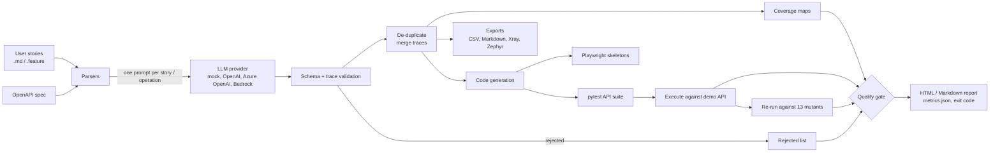
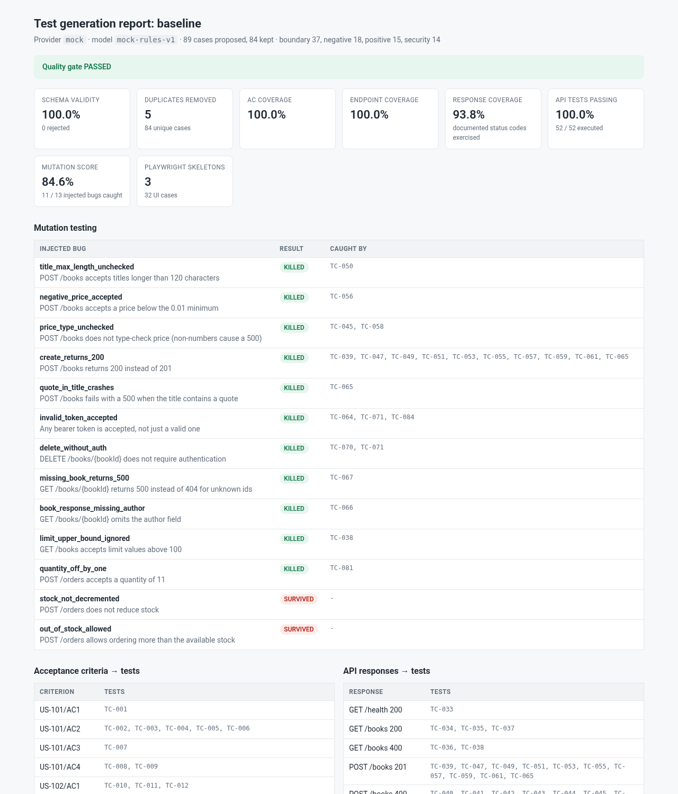
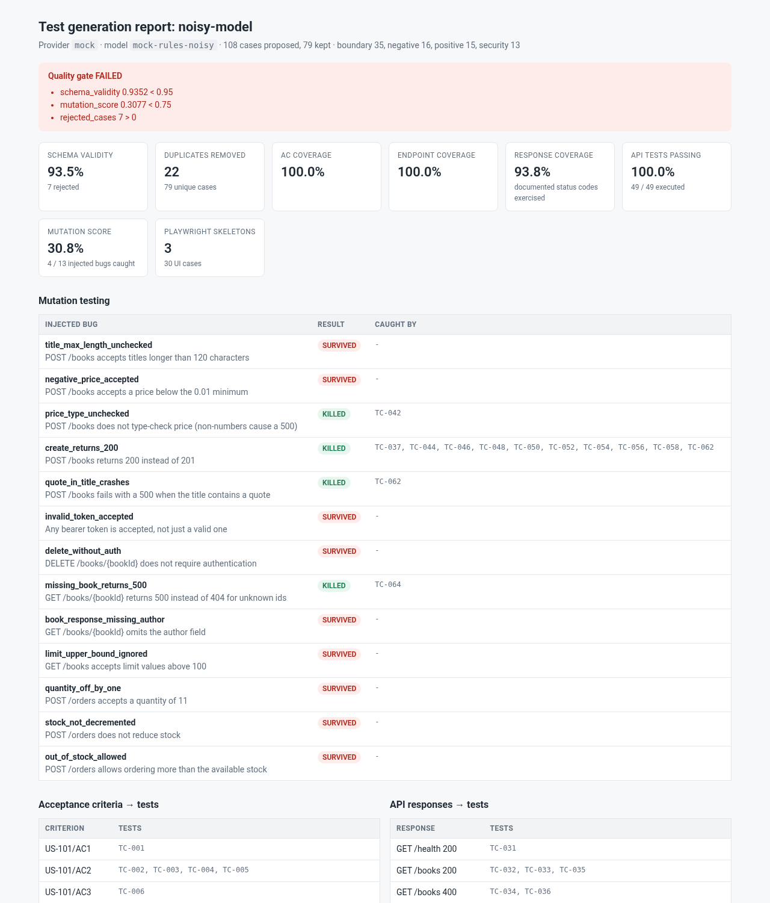

# ai-testcase-generator

[](https://github.com/karthickpearl1/ai-testcase-generator/actions/workflows/ci.yml)


Turns user stories and OpenAPI specs into structured test cases, runnable pytest API tests and
Playwright skeletons, then **measures whether the generated tests are any good** before
anyone relies on them.

I have spent most of my career in test automation, and the question I kept hearing about
LLM-generated tests was "how many did it write?". That is the wrong question. A generator that
writes 100 tests which all pass and catch nothing is worse than no generator, because it gives
false confidence. So this project treats the generator like any other system under test: every
run is checked for schema validity, traceability and coverage, the API tests are executed
against a real (demo) service, and then re-run against deliberately broken versions of that
service to see whether they notice.

It is a personal portfolio project. It runs fully offline with a deterministic mock model by
default; OpenAI, Azure OpenAI and AWS Bedrock are supported but optional.


## What it does

| Input | Output |
|---|---|
| User stories in Markdown (`AC1: ...`) or Gherkin `.feature` files | Manual test cases (steps, expected result, priority, type) with each case traced to its acceptance criterion |
| OpenAPI 3 spec | pytest API tests, one module per operation, with markers per test type |
| Both | Playwright (TypeScript) skeletons per story, coverage maps, CSV / Markdown / Xray-style / Zephyr-style JSON exports |

Every case is one of four types: **positive**, **negative**, **boundary** and **security**
(auth, IDOR, injection, password masking). Duplicates are removed and their traceability is
merged into the case that was kept.

Then the quality evaluation:

| Check | What it catches |
|---|---|
| **Schema validity** | Malformed model output, made-up acceptance criteria, requests to endpoints or status codes the spec does not document. Invalid cases are rejected and reported, never silently patched. |
| **AC / endpoint / response coverage** | Requirements with no test, and documented responses nobody exercises |
| **Execution** | Generated API tests run against the bundled Bookshop API; a correct API must pass them all |
| **Mutation score** | The same suite is re-run against 13 injected bugs (off-by-one limits, missing auth, wrong status codes, a 500 on a quote in a title...). A suite that does not fail on a broken API is not testing it. |
| **Quality gate** | Thresholds in YAML; exit code 1 in CI when a run does not meet them |

## Architecture



The model is asked for JSON only. Prompts embed the story or operation as a JSON block, the
response is validated against a JSON Schema, and then checked against the inputs: a case that
traces to `US-101/AC9` when the story has four criteria, or calls `GET /status` from the
`/health` prompt, is rejected rather than trusted.

## Quick start

Requires Python 3.11+.

```bash
git clone https://github.com/karthickpearl1/ai-testcase-generator.git
cd ai-testcase-generator
python -m venv .venv && source .venv/bin/activate
pip install -e ".[dev]"

testgen run --gate                    # generate, execute, mutation-test, gate (about 10 s)
open out/report.html                  # or xdg-open on Linux
```

Other commands:

```bash
testgen generate -o out/cases                       # cases, code and exports only, no execution
testgen run -c configs/noisy-model.yaml --gate      # a deliberately worse model: gate fails, exit 1
testgen demo-api --port 8000                        # run the Bookshop API yourself
testgen demo-api --port 8000 --mutant quantity_off_by_one
testgen demo-api --list-mutants
pytest -c sample-output/tests/api/pytest.ini sample-output/tests/api   # with demo-api running
pytest                                               # this project's own tests
```

Point the generated API suite at another environment with `API_BASE_URL` and `API_TOKEN`, or set
`evaluation.base_url` in the config (mutation testing is skipped there, because the mutants only
exist in the demo API).

### Using a real model

```bash
pip install -e ".[openai]"        # or ".[bedrock]"
cp .env.example .env              # fill in the provider you want, then export the variables
TESTGEN_PROVIDER=openai testgen run --gate -o out/openai
```

| Provider | Settings |
|---|---|
| `openai` | `OPENAI_API_KEY`, optional `OPENAI_MODEL` (default `gpt-4o-mini`) |
| `azure_openai` | `AZURE_OPENAI_API_KEY`, `AZURE_OPENAI_ENDPOINT`, `AZURE_OPENAI_DEPLOYMENT`, optional `AZURE_OPENAI_API_VERSION` |
| `bedrock` | Standard AWS credential chain, `AWS_REGION` (default `eu-west-2`), `BEDROCK_MODEL_ID` |

Nothing in the default path needs a key or network access. I have only exercised the real
provider adapters against fakes in the unit tests, so treat them as a starting point.

## Results

Both runs use the bundled examples: 3 user stories (12 acceptance criteria) and a 6-operation
Bookshop OpenAPI spec with 16 documented responses. These numbers come straight from
`metrics.json` and are reproducible because the mock model is deterministic.

| Metric | Baseline (`mock-rules-v1`) | Noisy model (`mock-rules-noisy`) |
|---|---:|---:|
| Cases proposed by the model | 89 | 108 |
| Rejected by schema / trace validation | 0 | 7 |
| Schema validity | 100.0% | 93.5% |
| Duplicates removed | 5 | 22 |
| Final cases (API / story) | 84 (52 / 32) | 79 (49 / 30) |
| Acceptance-criteria coverage | 100.0% | 100.0% |
| Endpoint coverage | 100.0% | 100.0% |
| Documented-response coverage | 93.8% | 93.8% |
| Generated API tests passing against the correct API | 52 / 52 (100%) | 49 / 49 (100%) |
| **Mutation score (injected bugs caught)** | **11 / 13 (84.6%)** | **4 / 13 (30.8%)** |
| Quality gate | PASSED (exit 0) | FAILED (exit 1) |

The baseline's 84 cases split into 37 boundary, 18 negative, 15 positive and 14 security.

The noisy model is the same rule set with three knobs turned: 10% of cases get a broken field,
15% are emitted twice, and API assertions are weakened to "status is one of the documented
codes". That last one is the failure mode I most wanted to catch, because it is exactly what
an LLM does when it is unsure.



### What the numbers show

**A 100% pass rate told me nothing.** The noisy model's tests all pass against the correct API,
and coverage is identical to the baseline: every acceptance criterion and endpoint is "covered".
Yet the suite caught only 4 of 13 injected bugs. It missed an endpoint that stopped requiring
authentication, a quantity limit that was off by one and a response with a missing field.
Pass rate and traceability measure that tests exist; only executing them against something
broken shows whether they check anything. That is why the gate has a mutation-score threshold
and not just a coverage one.

**Coverage gaps and surviving mutants point at the same hole.** The baseline's two surviving
mutants are `stock_not_decremented` and `out_of_stock_allowed`, and its one uncovered documented
response is `POST /orders 409` (out of stock). All three need stateful setup (create a book,
order it, order again) which single-request generated tests do not attempt. The tool reports that
honestly instead of hiding it, and it is the next thing I would add (see Roadmap).

**Duplicates hide in plain sight.** Even the clean baseline proposed 5 duplicates, mostly the same
injection or login check generated from two acceptance criteria. Merging their traces matters:
dropping a duplicate must not make a criterion look uncovered.



## Generated output

The committed [`sample-output/`](sample-output) folder is exactly what `testgen generate`
produces for the examples, and a test fails if it drifts, so changes to generated code show up
as reviewable diffs. A generated boundary test:

```python
@pytest.mark.boundary
def test_tc_050_title_above_maximum_length_120_is_rejected(api):
    """TC-050: Add a book to the catalogue: 'title' above maximum length (120) is rejected

    Traces: POST /books, POST /books 400
    """
    response = api.request(
        "POST",
        "/books",
        body={
            "title": "x" * 121,
            "author": "Emily Bronte",
            "price": 8.99,
            "stock": 25,
            "format": "paperback",
        },
        auth="valid",
    )
    assert response.status_code == 400, response.text
```

And a Playwright skeleton from a story:

```ts
test.fixme("TC-001: Verify the basket count increases by 1", async ({ page }) => {
  // Traces: US-101/AC1
  // Type: positive, priority: high
  await test.step("Given I am viewing a book that is in stock", async () => {
    await page.goto('/'); // TODO: navigate to the right starting page
  });
  await test.step("I click \"Add to basket\"", async () => {
    // TODO: perform this step, e.g.
    // await page.getByRole('button', { name: '...' }).click();
  });
  await test.step("Then the basket count increases by 1", async () => {
    // TODO: assert the outcome, e.g.
    // await expect(page.getByTestId('...')).toHaveText('...');
  });
});
```

Exports for test management tools are written to `exports/`: `test-cases.csv`,
`test-cases.md`, `xray.json` and `zephyr.json`. The JSON follows the general shape of Xray and
Zephyr Scale test imports (manual steps with data and expected result, project key, labels for
type and traceability); field mappings vary between instances, so check them against yours before
a bulk import.

## Design decisions

- **Measure the tests, not the generator's confidence.** Execution plus mutation testing is the
  core of the project. Coverage alone rewards volume; mutation score rewards tests that check
  behaviour.
- **Reject, don't repair.** Invalid model output is dropped and listed in the report with the
  reason. Auto-fixing it would hide how reliable the model really is, and schema validity is a
  gated metric for that reason.
- **Traceability is validated, not assumed.** A case must trace to an acceptance criterion or
  operation that exists in the input, and API cases may only use documented status codes.
- **The gate fails closed.** A threshold on a metric that was not measured (for example mutation
  score when execution is switched off) fails rather than passes.
- **Deterministic mock by default.** CI, the tests and the numbers in this README need no API key
  and give the same result every run. The mock reads the same JSON prompt a real model would, so
  the pipeline around it is exercised for real.
- **Playwright output is a skeleton, on purpose.** Steps, structure and traceability can be
  generated from a story; locators and assertions cannot be without seeing the UI. The specs use
  `test.fixme` so they show up as to-do rather than passing without checking anything. CI still
  type-checks them against the real `@playwright/test` types.
- **Generated code should look hand-written.** One module per operation, readable test names, a
  docstring with traces, markers per test type, and a standard-library HTTP client so the suite
  only needs pytest.
- **A demo API with known bugs.** A small standard-library Bookshop API ships with the package so
  that execution and mutation testing work offline. Each mutant is one realistic bug, and there is a
  unit test proving each one is observable.

## CI

[`.github/workflows/ci.yml`](.github/workflows/ci.yml) runs on every push and pull request:

1. `ruff check` and `ruff format --check`
2. `pytest` on Python 3.11, 3.12 and 3.13, with an 85% coverage floor
3. The quality gate on the examples, with the Markdown report written to the job summary and the
   full output uploaded as an artifact
4. A gate self-test: the noisy model **must** fail with exit code 1, otherwise the job fails
5. A TypeScript type-check of the generated Playwright skeletons

A separate manually triggered workflow (`live-generation.yml`) runs the same pipeline against a
real provider using repository secrets. It is never part of pull-request checks, because it costs
money and is not deterministic.

## Project layout

```text
src/ai_testgen/
  stories.py, openapi.py        input parsing (Markdown / Gherkin stories, OpenAPI with $ref)
  prompts.py, providers/        prompt templates; mock, OpenAI, Azure OpenAI and Bedrock clients
  rules/                        test design rules used by the mock model
  schema.py, dedupe.py          validation and de-duplication
  coverage.py, exporters.py     coverage maps; CSV, Markdown, Xray and Zephyr exports
  codegen/                      pytest and Playwright generators
  demo_api/                     Bookshop API and its 13 mutants
  evaluation.py, gate.py        execution, mutation testing, quality gate
  pipeline.py, report.py, cli.py
examples/                       sample stories and OpenAPI spec
configs/noisy-model.yaml        a deliberately worse model for the gate self-test
sample-output/                  committed output of `testgen generate`
typecheck/                      tsconfig for checking the Playwright skeletons
tests/                          unit and end-to-end tests
```

## Limitations

- The mock model is rule-based test design (equivalence partitioning, boundary values, auth and
  injection checks), not a language model. It stands in for one so the evaluation can be shown
  deterministically; the interesting part is what the evaluation does with any model's output.
- Generated API tests are single-request. Anything needing setup across calls (stock, order
  history) is out of reach today, and the report shows that as uncovered responses and surviving
  mutants.
- Story parsing expects `AC<n>:` lines or Gherkin scenarios. Free-form requirement documents are
  not supported.
- Mutation testing only works against the bundled demo API.

## Roadmap

- Stateful API scenarios (setup and teardown steps) to reach the 409 path and the two surviving
  mutants
- Feed surviving mutants back to the model as a second prompt ("write a test that fails when...")
- Real-model comparison runs in the live workflow, tracked over time like the
  [llm-eval-harness](https://github.com/karthickpearl1/llm-eval-harness) baseline

## Licence

[MIT](LICENSE) © Karthick Sivagnanam
